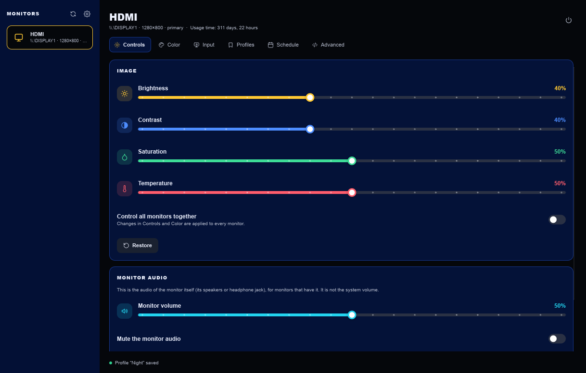
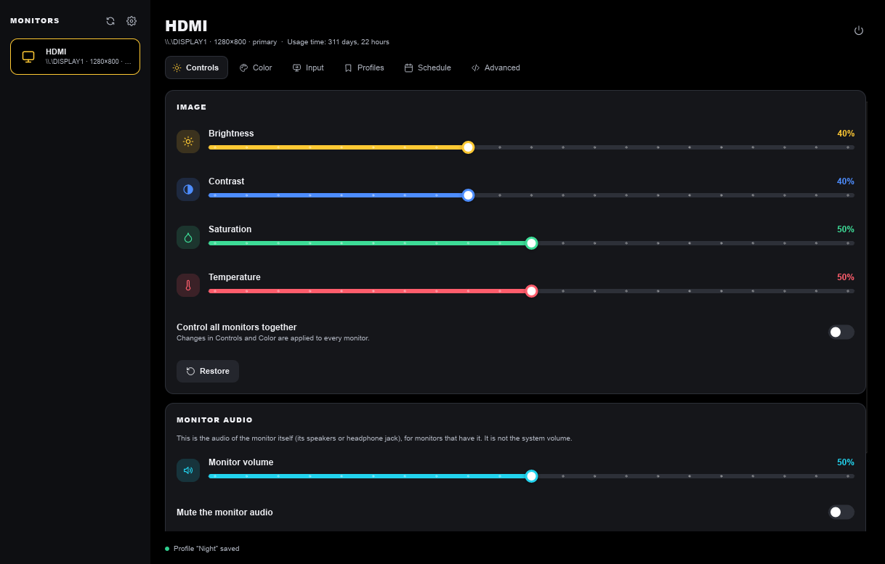
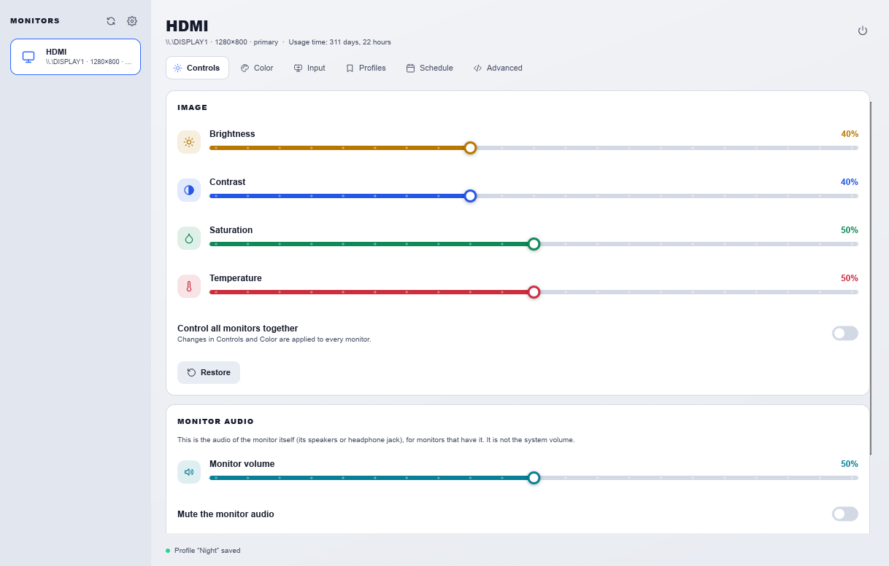
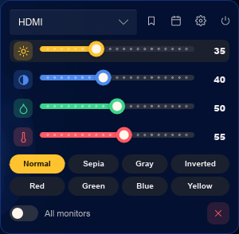
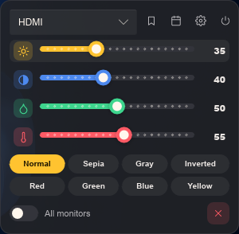
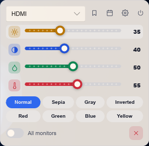

<div align="center">


# Solua

**A DDC/CI monitor controller built with Rust and Slint. Extremely light and fast.**

Windows · Linux (Wayland)

</div>

<p align="center">
  
  
  
</p>

<p align="center">
  
  
  
</p>

## Download

Get the latest build from the [Releases](https://github.com/uenzuwkxos/Solua/releases) page:

| System | File |
|---|---|
| Windows | `Solua-x64.exe` (or `Solua-x86.exe` for 32-bit); no installation needed |
| Debian, Ubuntu, Mint… | `solua_<version>_amd64.deb` |
| Fedora, openSUSE, Arch… and any other Linux | `Solua-<version>-x86_64.AppImage` (make it executable and run it) |

On Linux, monitors are reached through `/dev/i2c-*`. The `.deb` sets that up. With the
AppImage, Solua shows an **Enable monitor access** button the first time it cannot reach your monitors.

## Features

- Brightness, contrast, saturation, color temperature, RGB gains and monitor audio, per monitor or for all at once.
- Input source switching (HDMI, DisplayPort, USB-C…), color presets and power control.
- **Profiles** that store a full set of settings, and a **schedule** that applies them at a given time and day.
- **Global shortcuts** for brightness, contrast, temperature, volume and profiles.
- Light, Dark (blue, violet or default) and Black themes; settings backup and restore.
- Windows extras: tray icon and mini panel, on-screen indicator, software color filter.
- Private by design: no accounts, no analytics, no network connections.

Languages: English, Português (Brasil), Español, Deutsch, Français, Italiano, Nederlands, Polski,
Русский, 简体中文, 日本語, 한국어, हिन्दी, العربية, Bahasa Indonesia.

## Building

Requires the stable [Rust toolchain](https://rustup.rs). Pushing a `v*` tag makes GitHub Actions build
every file above and attach it to a release (`.github/workflows/release.yml`).

**Windows**

```
cargo build --release
```

Produces `target\release\Solua.exe`, with no extra runtime requirements. The included GitHub Actions
workflow builds 64-bit and 32-bit executables.

**Linux** (Debian/Ubuntu example)

```
sudo apt install build-essential pkg-config libfontconfig1-dev libxkbcommon-dev libwayland-dev
cargo build --release
```

To build the Linux packages locally run `packaging/linux/build.sh` (needs `cargo-deb`).

Global shortcuts work through the desktop's GlobalShortcuts portal (KDE Plasma, GNOME 48+) or through
custom keybindings on XFCE and older GNOME.

## Contributing

Translations live in `lang/<locale>/LC_MESSAGES/Solua.po`; improvements and new languages are welcome.

## Disclaimer

This application was developed using AI and was guided, tested, designed, and also built by me, the maintainer.
Translations are AI-generated and may contain mistakes; corrections are welcome.

## License

Free software under the **GNU GPL v3.0 or later**. See [LICENSE](LICENSE).
